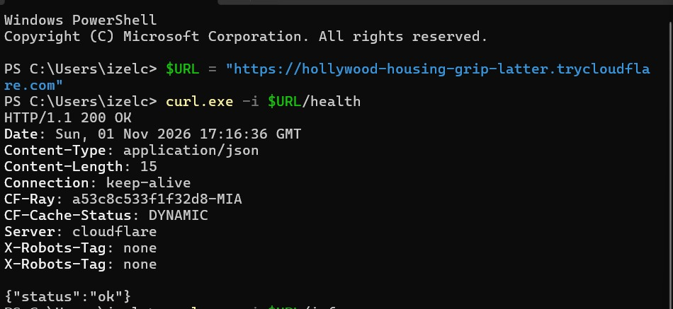
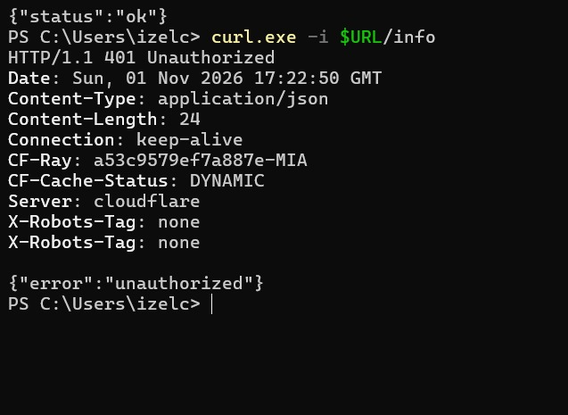
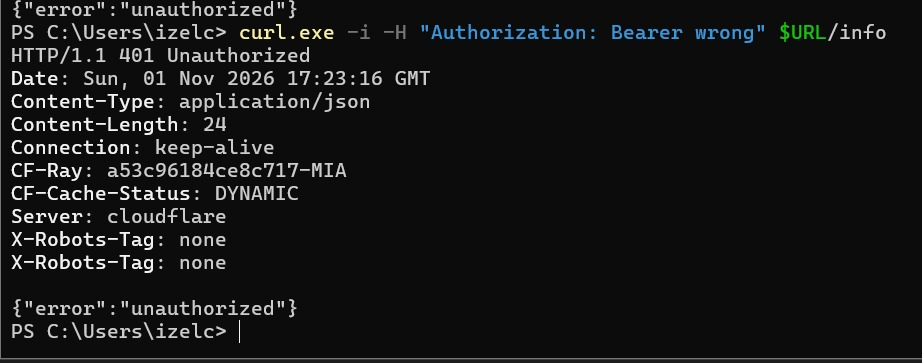
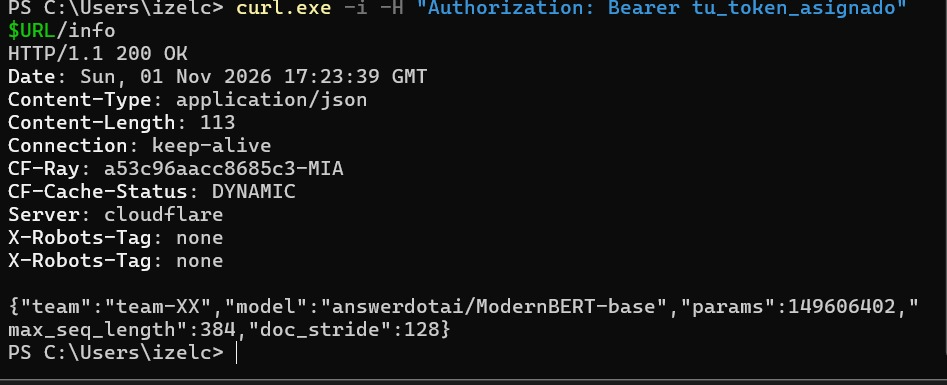
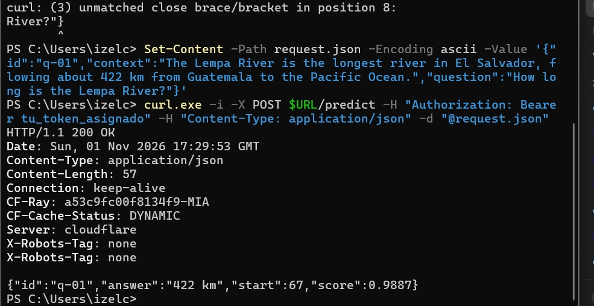
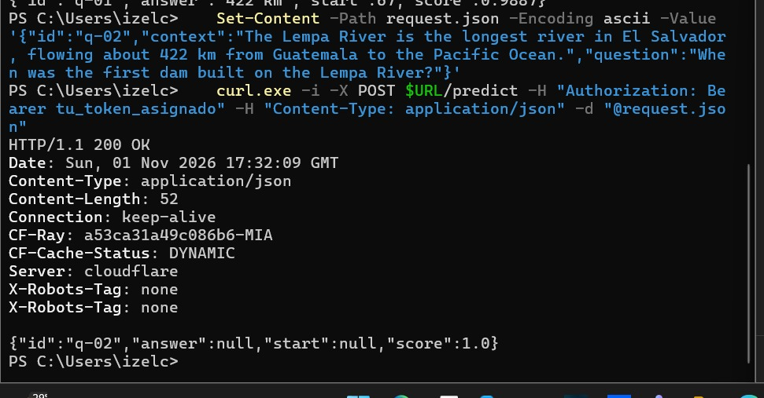

# Dry run — team-03

Evidence of the dry run required in Section XI of the brief, run **through the public tunnel** (not localhost),
following the curl tests of Section IX ("Testing with curl").

| Item | Value |
|---|---|
| Service | `app.py` (FastAPI + Uvicorn), model `answerdotai/ModernBERT-base` fine-tuned on SQuAD 2.0 |
| Tunnel | Cloudflare Quick Tunnel |
| Public URL | `https://hollywood-housing-grip-latter.trycloudflare.com` |
| Date | 2026-11-01, 17:16–17:32 GMT |
| Client | Windows PowerShell, `curl.exe` |

## Results

| # | Test | Expected | Result | Screenshot |
|---|---|---|:---:|---|
| 1 | `/health`, no token | 200 `{"status": "ok"}` | ✅ 200 `{"status":"ok"}` | [01_health.png](01_health.png) |
| 2 | `/info`, no token | 401 | ✅ 401 `{"error":"unauthorized"}` | [02_info_sin_token.png](02_info_sin_token.png) |
| 3 | `/info`, wrong token | 401 | ✅ 401 `{"error":"unauthorized"}` | [03_info_token_incorrecto.png](03_info_token_incorrecto.png) |
| 4 | `/info`, valid token | 200 with team, model, params | ✅ 200, `model: answerdotai/ModernBERT-base`, `params: 149606402` | [04_info_token_valido.png](04_info_token_valido.png) |
| 5a | `/predict`, valid token (answerable) | 200 with id, answer, start, score | ✅ 200, `answer: "422 km"`, `start: 67` | [05_predict_contestable.png](05_predict_contestable.png) |
| 5b | `/predict`, valid token (unanswerable) | 200, `answer: null` | ✅ 200, `answer: null`, `start: null` | [06_predict_no_contestable.png](06_predict_no_contestable.png) |

Test 5 used the two examples from `qa_api_contract.yaml`, with the same Lempa River context:

- **q-01** "How long is the Lempa River?" → `"422 km"`, `start = 67`. The offset holds:
  `context[67:73] == "422 km"`. The reference in the contract is `"about 422 km"`. This is a partial match: F1 is high, but it is not an exact match.
- **q-02** "When was the first dam built on the Lempa River?" → `null`. This is the trick question: the context
  mentions the river but not the dam, and the service correctly abstains.

## Screenshots

### 1. `/health`, no token → 200

### 2. `/info`, no token → 401

### 3. `/info`, wrong token → 401

### 4. `/info`, valid token → 200

### 5a. `/predict`, answerable question → 200

### 5b. `/predict`, unanswerable (trick) question → 200 with `answer: null`

## Notes

- `/info` returned `"team": "team-XX"` because `TEAM_NAME` was not set in the terminal that ran the service.
  `app.py` now defaults to `team-03`, so this happens no matter how the service is started.
