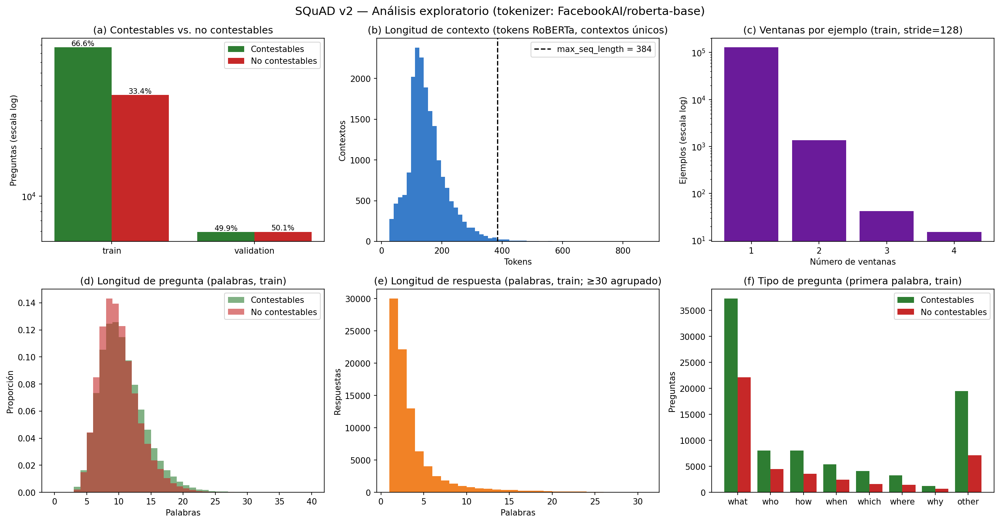
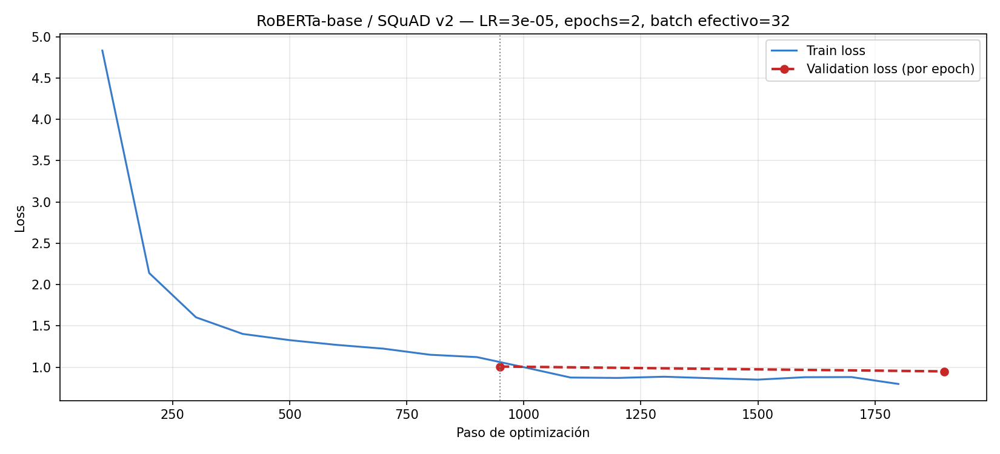
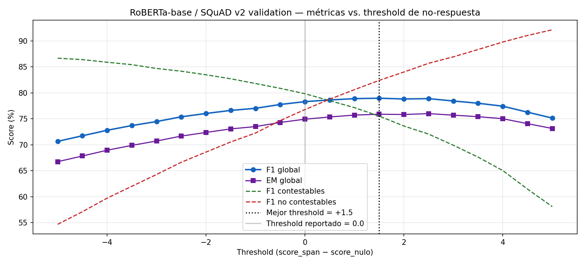

# logs_roberta — RoBERTa-base fine-tuned en SQuAD v2

Resultados reales del fine-tuning de `FacebookAI/roberta-base` para Extractive QA en SQuAD v2.
Generado automáticamente por `pipeline_roberta/03_error_analysis_roberta.ipynb`.

## Resultados (validation, 11,873 preguntas, threshold = 0.0)

| Subconjunto | EM | F1 | n |
|---|---|---|---|
| **Global** | **74.93** | **78.31** | 11,873 |
| Contestables | 73.06 | 79.84 | 5,928 |
| No contestables | 76.79 | 76.79 | 5,945 |

Mejor threshold en la búsqueda: **+1.5**
(F1 78.97; optimista porque se eligió sobre validation).

## Entrenamiento

| Parámetro | Valor |
|---|---|
| Modelo base | `FacebookAI/roberta-base` |
| Train | 30,000 ejemplos (30,353 ventanas) |
| Validation | 11,873 ejemplos |
| Epochs | 2 |
| Learning rate | 3e-05 (linear, warmup 10%) |
| Batch | 16 × 2 = 32 efectivo |
| max_seq_length / doc_stride | 384 / 128 |
| GPU | Tesla T4 (fp16) |
| Tiempo de entrenamiento | 0.37 h (1 sesión(es)) |
| Parámetros | 124,056,578 |
| Tamaño de pesos | 473.3 MB |
| Latencia CPU (media / p95) | 401.6 / 622.1 ms (Google Colab, 2 CPUs) |

## Archivos

| Archivo | Contenido |
|---|---|
| `eda_squad2.png`, `eda_stats.json` | Análisis exploratorio de SQuAD v2 |
| `loss.png` | Pérdida de entrenamiento y validación |
| `train_results.json` | Configuración exacta, hardware, tiempo, tamaño |
| `eval_results.json` | EM/F1 global, contestables y no contestables; latencia CPU |
| `threshold_search.png` | Métricas vs. threshold de no-respuesta |
| `error_analysis.json` | Tipos de error y ejemplos correctos/incorrectos |
| `ROBERTA_COMPARISON.md` | Ficha comparativa con ModernBERT |

